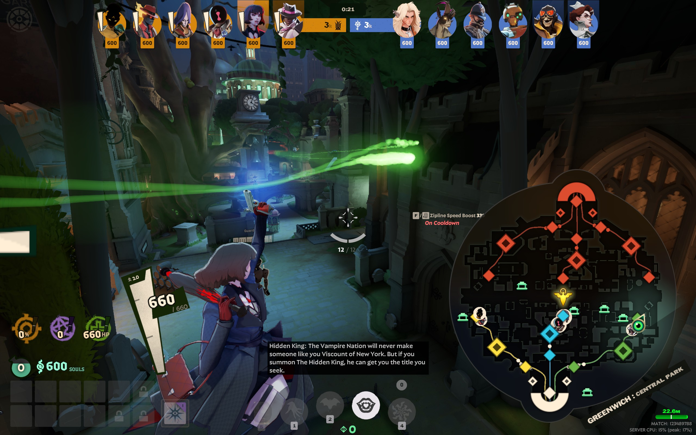
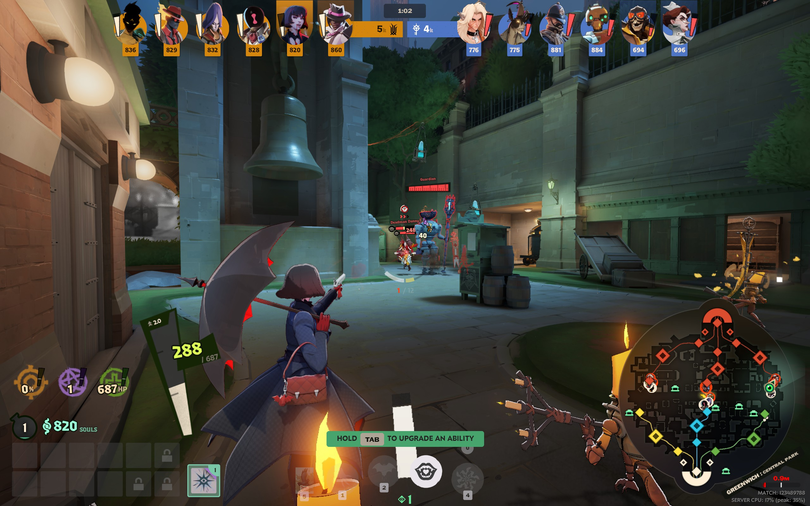

# BiggerIdleMap

[](https://gamebanana.com/mods/731543)

Shows the minimap at 1.5× its normal size while you're not fighting. It returns to normal size while
any of these is true:

- you're in combat (the game's own in-combat state)
- you're holding Tab (scoreboard)
- you're zoomed in (ADS)
- you're reloading

The whole minimap widget scales: map, icons, frame and district name. It stays in the bottom-right
corner.

| Not fighting | In combat |
| --- | --- |
|  |  |

## Install

With [Grimoire](https://grimoiremods.com/) or Deadlock Mod Manager, or by hand:

1. Copy `pak01_dir.vpk` into `Deadlock\game\citadel\addons\`. If that name is taken, rename it to
   the next free number (`pak02_dir.vpk`, ...).
2. Make sure `gameinfo.gi` mounts `citadel/addons`. Mod managers do this.
3. Restart Deadlock.

## Compatibility

- Only changes UI files: one layout, one stylesheet, one script.
- Replaces `panorama/layout/hud.xml`, so it conflicts with other mods that replace that file.
- Built for Deadlock build 6819 (October 22, 2026). A game update that changes the HUD can turn the
  mod off until it's rebuilt.

In-combat state is set when you hit an enemy hero, or when a hero, neutral or trooper hits you.
Damage you deal to troopers or neutrals doesn't count.

## How it works

The four conditions are classes the game's C++ HUD already sets:

| Condition | Class | Panel |
| --- | --- | --- |
| In combat | `gInCombat` (global) | mirrored onto `#minimap_persp`, see below |
| Scoreboard (Tab) | `gScoreboardOpen` (global) | mirrored onto `#minimap_persp`, see below |
| Zoomed | `isZoomed` | `#health_and_abilities_container` |
| Reloading | `reloading` | the crosshair's gun element (`.ability_element_gun`) |

A `<GlobalClassListener classes="..."/>` mirrors global classes onto its parent panel, so the mod
adds one inside the minimap's wrapper in `panorama/layout/hud.xml`:

```xml
<GlobalClassListener id="minimap_persp" hittest="false" classes="gDetailView gScoreboardOpen">
    <GlobalClassListener hittest="false" classes="gInCombat gScoreboardOpen" />   <!-- added -->
```

Zooming and reloading aren't global classes, and Panorama CSS can't select on unrelated panels, so
`panorama/scripts/bigger_idle_map.vts` (also included from `hud.xml`) polls all four 20 times a
second. When none is set, it puts `biggerIdleMapEnlarged` on `#minimap_persp`.

`panorama/styles/bigger_idle_map.css` only styles `#minimap_persp.biggerIdleMapEnlarged`, scaling the
whole minimap widget with `ui-scale`. Without the class, vanilla styling applies, which is also what
happens if the script fails.

## Build

Requirements: Windows, [uv](https://docs.astral.sh/uv/), and Deadlock installed through Steam.

```powershell
uv run build.py               # -> dist/biggerIdleMap-<version>.zip, containing pak01_dir.vpk
```

Options: `--scale 1.5` sets the enlarged size relative to vanilla (at most about 2.05), and
`--game <path>` overrides the auto-detected install (`DEADLOCK_PATH` works too).

The build:

1. Decompiles the installed game's `panorama/layout/hud.vxml_c` and `panorama/styles/hud.vcss_c`
   with Source2Viewer-CLI, fetched into `.tools/` on first run and pinned by version and SHA-256.
2. Patches `hud.xml` at three anchors and checks `--scale` against the vanilla minimap size in
   `hud.css`. If a game update changes any of these, the build stops and says which.
3. Compiles the XML and `src/` into Source 2 resources (`panorama.py`) and syntax-checks the script
   with `node --check` if Node is installed. No CSDK or `resourcecompiler.exe` is needed.
4. Reads every compiled file back with Source2Viewer-CLI.
5. Packs `pak01_dir.vpk` and zips it.

## License

Written with Claude Opus 5.5 (Anthropic).

Available under the [AGPLv3](LICENSE) (or later). `panorama.py` also carries its upstream MIT notice.

## Credits

- [Vergir/deadlock-hud-resize](https://github.com/Vergir/deadlock-hud-resize) (MIT): the Panorama
  resource compiler code, adapted.
- [ValveResourceFormat/ValveResourceFormat](https://github.com/ValveResourceFormat/ValveResourceFormat)
  (MIT): Source2Viewer-CLI, used to decompile the game's HUD files.
- [ValvePython/vpk](https://github.com/ValvePython/vpk) (MIT): VPK packing.
